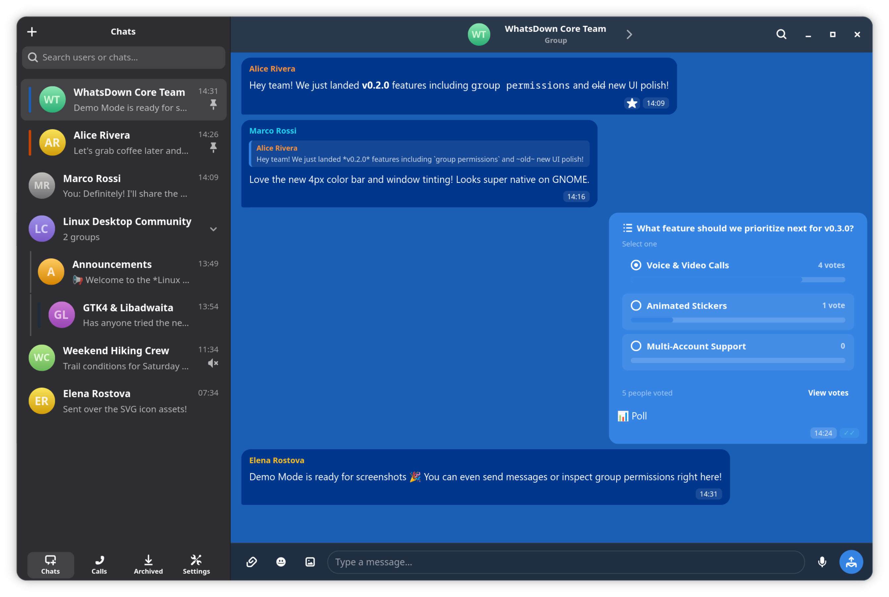

<p align="center">
  
</p>

<h1 align="center">WhatsDown</h1>

<p align="center">
  A native Linux WhatsApp desktop client built with <b>Go</b>, <b>GTK 4</b>, and <b>Libadwaita</b>.
</p>

---
<p align="center">
  
</p>

---

## Branch Info

This is the main branch. No active development (usually) will be done here anymore, and all active development will be on the latest branch version. You can assume the code here to be safe and (mostly) production-ready.

---

## Features

- **Native GNOME Experience:** Built with GTK 4 and Libadwaita, seamlessly integrating with system dark mode and GNOME desktop aesthetics.
- **Instant QR Pairing & Sync:** Fast multi-device pairing with persistent sessions and background history synchronization.
- **Voice Messages (PTT):** Built-in voice message recorder with interactive live audio waveforms, pause/resume, review playback, and Opus encoding.
- **Rich Messaging:** Message editing, message revoking/deleting, delivery/read receipts, reply previews, and formatted text.
- **Interactive Polls & Stickers:** Vote in single or multi-choice polls with live percentage bars, plus a native sticker picker and personal sticker collection.
- **Call History:** Dedicated Calls page tracking incoming, outgoing, and missed voice and video calls with timestamps.
- **WhatsApp Communities:** Collapsible server-style community folders grouping member chats with unread counters.
- **Clipboard & Drag-and-Drop:** Directly paste images and screenshots from the clipboard (`Ctrl+V`), or drag and drop files from your file manager.
- **Emoji Autocomplete:** Inline fuzzy emoji search by typing `:` (e.g. `:fire`, `:laugh`, `:heart`), fully keyboard-navigable.
- **Media Gallery & Details:** Shared photos and videos organized in a thumbnail gallery grid alongside documents and voice notes.
- **Presence & Typing Indicators:** Real-time online status and animated typing bubbles for active contacts.
- **Pinned & Archived Chats:** Full cross-device synchronization for pinned and archived conversations.
- **Local SQLite Storage:** Fast, private, on-device caching of chats, messages, and contact avatars following XDG specifications.

---

## Emoji Font Support & Apple Color Emoji Disclaimer

WhatsDown styles chat text, emoji autocomplete, and reaction pickers with a cross-platform emoji font stack:

```css
font-family:
  "Apple Color Emoji", "Noto Color Emoji", "Segoe UI Emoji", "Twemoji Mozilla", sans-serif;
```

### Apple Emoji Disclaimer

> [!NOTE]
> **Emoji Font Disclaimer:**
> Official WhatsApp clients utilize Apple-designed emoji artwork: native **Apple Color Emoji** on iOS and macOS, and a custom Apple-styled emoji set on Android and WhatsApp Web.
>
> On Linux desktop environments, WhatsDown prioritizes `"Apple Color Emoji"` first, so users who have the font installed on their system can enjoy the authentic WhatsApp emoji aesthetic. If `"Apple Color Emoji"` is not installed, the application automatically falls back to system color emoji fonts such as **Noto Color Emoji** or **Segoe UI Emoji**.
>
> **Notice:** **Apple Color Emoji** is a proprietary trademark and copyright of **Apple Inc.** WhatsDown is an independent open-source project and does **not** bundle, distribute, or license proprietary Apple fonts. Users wishing to use Apple Color Emoji under Linux must provide their own legally acquired font files in compliance with Apple's software license agreements.

---

## Installation

WhatsDown can be installed via pre-built packages or compiled from source.

### Ubuntu (Launchpad PPA)

Available for Ubuntu **Stonking** (26.10) and **Tenacious** (27.04):

```bash
sudo add-apt-repository ppa:emiroven/whatsdown
sudo apt update
sudo apt install whatsdown
```

---

### Fedora & openSUSE (COPR)

Available for **Fedora 45** and **openSUSE Tumbleweed** via Fedora COPR:

#### Fedora 45

```bash
sudo dnf copr enable emiroven/WhatsDown
sudo dnf install whatsdown
```

#### openSUSE Tumbleweed

```bash
# Add the COPR repository via zypper
sudo zypper addrepo https://copr.fedorainfracloud.org/coprs/emiroven/WhatsDown/repo/opensuse-tumbleweed/emiroven-WhatsDown-opensuse-tumbleweed.repo
sudo zypper refresh
sudo zypper install whatsdown
```

_(Or if using DNF on Tumbleweed: `sudo dnf copr enable emiroven/WhatsDown && sudo dnf install whatsdown`)_

---

### Arch Linux (From Source using PKGBUILD)

You can build and install directly from source using the provided `PKGBUILD`:

```bash
# 1. Clone the repository
git clone https://github.com/EmirOven/WhatsDown.git
cd WhatsDown/packaging/aur

# 2. Build and install with dependencies (-s: resolve deps, -i: install, -c: clean up)
makepkg -sic
```

If you use an AUR helper like `yay` or `paru`:

_I am unable to host on AUR right now as AUR account registrations have been closed for months due to some abuse of the platform. Neither I nor the AUR team know if or when it will open, and what new restrictions might be put in place. So for now, you need to build from source using `makepkg` as told above._

---

### Flatpak (Any Linux Distribution)

Flatpak support is coming! They require quite a bit more to distribute on their platform so it will take some time before I can finish the requirements and they review my application.

## Prerequisites

Ensure you have the following system dependencies installed:

### Debian / Ubuntu

```bash
sudo apt install -y \
  golang \
  libgtk-4-dev \
  libadwaita-1-dev \
  libgirepository1.0-dev \
  gobject-introspection \
  blueprint-compiler \
  libsqlite3-dev \
  gcc \
  pkg-config
```

### Fedora

```bash
sudo dnf install -y \
  golang \
  gtk4-devel \
  libadwaita-devel \
  blueprint-compiler \
  sqlite-devel \
  gcc \
  pkgconf-pkg-config
```

### Arch Linux

```bash
sudo pacman -S --needed \
  go \
  gtk4 \
  libadwaita \
  blueprint-compiler \
  sqlite \
  gcc \
  pkgconf
```

---

## Building and Running

### Development Mode (with Live Reload)

The repository includes a development script `run.sh` that watches for file changes:

- Changes to `ui/*.blp` are automatically recompiled into `.ui` via `blueprint-compiler`.
- Changes to UI templates and CSS files are reloaded directly into the running application.
- Changes to Go source code trigger an automatic recompile and restart.

To start in development mode:

```bash
./run.sh
```

To preview individual screens directly without pairing:

```bash
# Preview the syncing progress screen:
WHATSDOWN_DEV_PAGE=syncing ./run.sh

# Preview the main chat interface:
WHATSDOWN_DEV_PAGE=main ./run.sh
```

### Standard Run (Embedded Assets)

Since XML `.ui` files are compiled from Blueprint source files (`.blp`) and not tracked in Git, compile them first before building:

```bash
blueprint-compiler batch-compile ui ui ui/*.blp ui/components/*.blp
WHATSDOWN_DEV=0 ./run.sh
```

Or build the binary directly:

```bash
blueprint-compiler batch-compile ui ui ui/*.blp ui/components/*.blp
go build -o whatsdown .
./whatsdown
```

### Running Tests

```bash
go test -v ./...
```

---

## Support & Donations

If you enjoy using WhatsDown and would like to support its ongoing development and maintenance, donations are greatly appreciated!

[](https://liberapay.com/postbeta)
[](https://buymeacoffee.com/postbeta)

---

## License

This project is licensed under the [MIT License](LICENSE).

---

## AI Notice

AI is used as a tool in this project. All code is user-generated, or user-reviewed before being sent. Contributions that are found to be completely 'vibecoded' will not be accepted.
